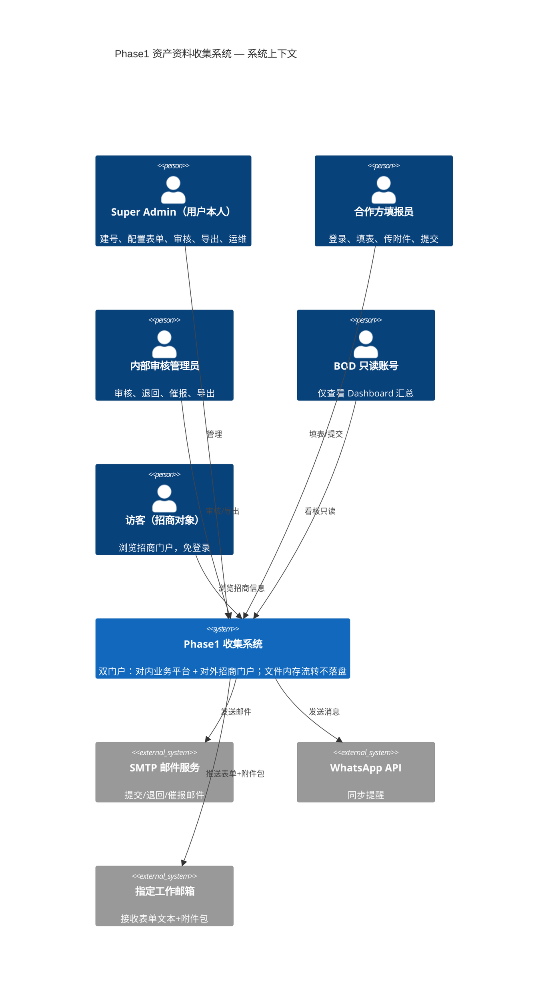
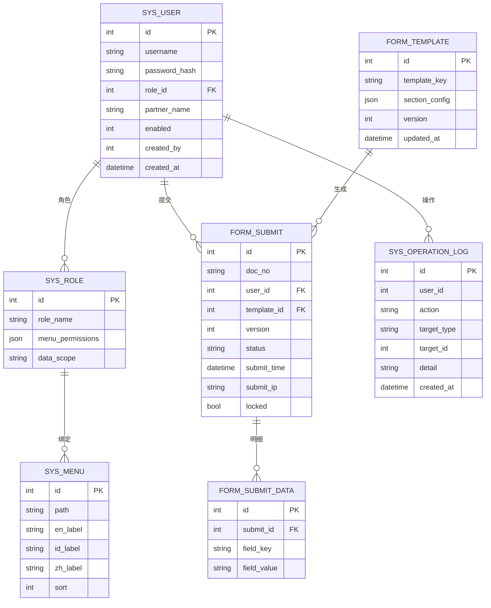

# Phase1 资产与前置资料收集系统 — 完整架构文档（交付物1）

> 用途：作为新建豆包项目的核心架构输入，覆盖 C4 架构图、ER 数据模型、接口清单。
> 配套文件：`system-design-phase1.md`（业务约束）、`deliverable2-github-setup.md`（部署配置）。
> 技术栈：React18 + Vite + TS + AntD5 + Node.js/Express + SQLite（可迁移 MySQL）+ GitHub Actions。

---

## 一、C4 架构图（Level 1 — 系统上下文）



---

## 二、C4 架构图（Level 2 — 容器 / 前后端分离）

```mermaid
C4Container
    title Phase1 收集系统 — 容器图

    Container_Boundary(front, "前端层") {
        Container(spa, "内部业务平台 SPA", "React18+AntD5", "RBAC动态路由、三语切换、填报/审核/Dashboard")
        Container(portal, "对外招商门户", "静态页面", "项目介绍、招商信息、免登录")
    }

    Container_Boundary(back, "后端服务层") {
        Container(gw, "API 网关", "Express + JWT", "鉴权、路由、RBAC拦截")
        Container(svc, "业务服务模块", "Node.js", "账号/表单/填报/审核/通知/导出/日志/看板")
        Container(file, "文件内存处理", "Stream流", "打包附件→邮件，不落盘")
        Container(sched, "定时任务", "node-schedule", "7天催报/2个月停催")
    }

    ContainerDb(db, "SQLite 数据库", "SQLite(可迁MySQL)", "业务/权限/日志表；提交记录只读锁")

    Rel(spa, gw, "HTTPS/JSON")
    Rel(portal, gw, "只读公共接口")
    Rel(gw, svc, "调用")
    Rel(svc, file, "处理附件")
    Rel(svc, db, "读写")
    Rel(svc, sched, "触发")
    Rel(svc, smtp_ext, "邮件")
    Rel(svc, wa_ext, "WhatsApp")
```

---

## 三、C4 架构图（Level 3 — 核心模块 & 数据流）

```mermaid
flowchart TB
    subgraph 填报链路
        A[合作方登录] --> B[打开Phase1表单]
        B --> C[填写文本+上传附件]
        C --> D[保存草稿/提交]
        D --> E{提交}
        E --> F[后端内存Stream接收文件]
        F --> G[内存打包附件]
        G --> H[推送:邮件(文本+附件包)+WhatsApp提醒]
        H --> I[内存流销毁,服务器无文件残留]
        E --> J[表单文本+提交日志写入DB]
        J --> K[form_submit 记录只读锁]
    end

    subgraph 审核链路
        L[审核管理员登录] --> M[查看单据]
        M --> N{审核}
        N -->|通过| O[标记审核完成]
        N -->|退回| P[手写备注]
        P --> Q[邮件+WhatsApp通知补件]
    end

    subgraph 自动任务
        R[node-schedule] --> S[逾期7天→催报邮件]
        R --> T[满2个月→停止催报,标记放弃]
    end

    subgraph 输出链路
        U[导出请求] --> V{导出类型}
        V -->|Excel| W[资产+资质汇总表]
        V -->|PDF| X[表单归档文档]
        V -->|ZIP| Y[附件打包包]
        V -->|协议附件| Z[预填充文档]
        W & X & Y & Z --> AA[语言跟随前端选中语种]
    end

    subgraph 看板
        AB[Dashboard] --> AC[项目进度/逾期清单/完成率]
        AC --> AD[BOD只读查看]
    end
```

---

## 四、ER 数据模型（核心表）



### 关键约束说明
- `FORM_SUBMIT`：提交成功后 `locked=true`，**数据库层禁止 UPDATE / DELETE**（仅允许 SELECT）。
- `SYS_OPERATION_LOG`：只增不删，永久留痕，满足 BOD 审计。
- 文件**不进入任何数据库表**；仅表单文本入 `FORM_SUBMIT_DATA`。

---

## 五、接口清单（REST API）

### 5.1 认证与账号（Admin 专属）
| 方法 | 路径 | 说明 | 权限 |
|---|---|---|---|
| POST | /api/auth/login | 用户名密码登录，返回 JWT | 公开(登录页) |
| GET | /api/auth/me | 获取当前用户信息+角色菜单 | 登录 |
| POST | /api/admin/users | 创建账号 | Super Admin |
| PUT | /api/admin/users/:id | 启用/停用账号 | Super Admin |
| GET | /api/admin/users | 用户列表 | Super Admin |
| POST | /api/admin/roles | 新建角色 | Super Admin |
| PUT | /api/admin/roles/:id | 配置角色权限 | Super Admin |

### 5.2 表单配置（Admin 可视化编辑）
| 方法 | 路径 | 说明 | 权限 |
|---|---|---|---|
| GET | /api/admin/templates | 表单模板列表 | Super Admin/审核 |
| POST | /api/admin/templates | 新建表单模板 | Super Admin |
| PUT | /api/admin/templates/:id | 编辑字段/增删条目 | Super Admin |
| GET | /api/forms/:templateKey | 合作方获取当前表单配置 | 填报员 |

### 5.3 填报与提交（核心文件内存流转）
| 方法 | 路径 | 说明 | 权限 |
|---|---|---|---|
| POST | /api/forms/draft | 保存草稿（仅文本入DB，不存文件） | 填报员 |
| POST | /api/forms/submit | 正式提交（文本入DB；文件流打包→邮件→销毁） | 填报员 |
| GET | /api/forms/my/submits | 我的提交记录 | 填报员 |

### 5.4 审核与退回
| 方法 | 路径 | 说明 | 权限 |
|---|---|---|---|
| GET | /api/review/submits | 全部单据列表 | 审核管理员 |
| POST | /api/review/:id/approve | 审核通过 | 审核管理员 |
| POST | /api/review/:id/reject | 退回补件（手写备注） | 审核管理员 |
| POST | /api/review/:id/remind | 手动催报 | 审核管理员 |

### 5.5 通知
| 方法 | 路径 | 说明 | 权限 |
|---|---|---|---|
| POST | /api/notify/email | 发邮件（内部调用） | 服务内部 |
| POST | /api/notify/whatsapp | 发 WhatsApp 提醒（内部调用） | 服务内部 |

### 5.6 导出（语言跟随前端选中语种）
| 方法 | 路径 | 说明 | 权限 |
|---|---|---|---|
| GET | /api/export/excel?lang= | 导出资产+资质汇总 Excel | 审核管理员 |
| GET | /api/export/pdf?lang= | 导出表单归档 PDF | 审核管理员 |
| GET | /api/export/zip?lang= | 导出附件打包 ZIP（仅文字清单+指向工作邮箱说明） | 审核管理员 |
| GET | /api/export/agreement?lang= | 导出预填充协议附件文档 | 审核管理员 |

### 5.7 看板 Dashboard
| 方法 | 路径 | 说明 | 权限 |
|---|---|---|---|
| GET | /api/dashboard/summary | 项目进度/逾期/完成率汇总 | 审核/BOD 只读 |
| GET | /api/dashboard/detail | 明细（仅审核管理员可见，BOD 只读不可见） | 审核管理员 |

### 5.8 对外招商门户（免登录）
| 方法 | 路径 | 说明 | 权限 |
|---|---|---|---|
| GET | /api/public/project | 项目介绍（多语言） | 公开 |
| GET | /api/public/invest | 招商信息 | 公开 |

> 安全约定：所有业务接口经 JWT 鉴权 + RBAC 拦截；合作方只能访问 `my` 作用域数据（数据权限隔离），无法读取其他合作方单据。

---

## 六、关键非功能需求（NFR）
1. **文件零落盘**：附件仅 Stream 内存处理，打包推送邮件后销毁；无持久化附件存储。
2. **数据不可篡改**：提交记录只读锁 + 日志只增。
3. **账号安全**：无自助注册；Admin 手动建号；JWT 短期令牌 + 强密码。
4. **多语言**：三语词库独立（en/id/zh），禁止音译；导出跟随语种。
5. **定时任务可靠**：node-schedule 任务持久化，服务重启自动恢复。
6. **权限最小化**：RBAC 四级控制，BOD 仅看汇总。
7. **可迁移**：SQLite→MySQL 无缝切换；前端静态部署绑定独立域名即可。

---

## 七、开发里程碑
| 阶段 | 内容 | 预计周期 |
|---|---|---|
| M1 | 后端：认证/RBAC/表单配置/填报/文件流邮件 | 3~4 天 |
| M2 | 前端：登录/动态菜单/三语/填报表单 | 3~4 天 |
| M3 | 审核/退回/通知/定时催报 | 2~3 天 |
| M4 | 导出/日志/Dashboard | 2~3 天 |
| M5 | 联调 + GitHub Actions 测试部署 | 2 天 |
| 合计 | 试点可上线 | 约 12~14 天 |
